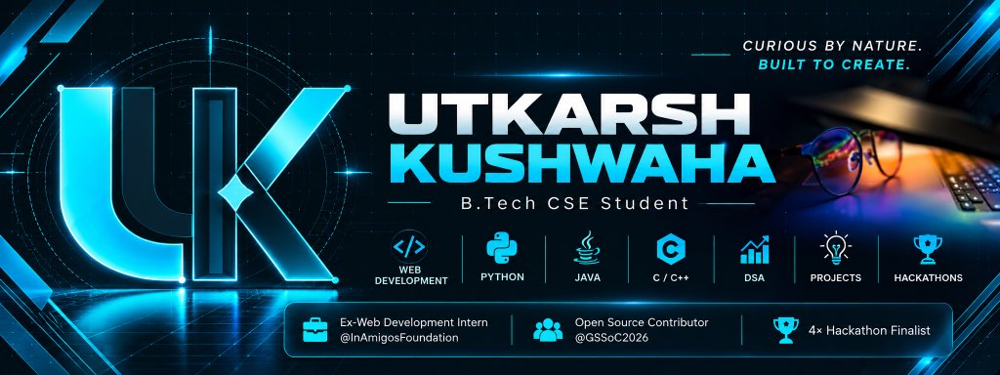

<div align="center">

  <!-- Header Banner -->
  

  <!-- Animated Typing Tagline -->
  <a href="https://github.com/utkarshkushwaha159">
    
  </a>

  <br/>

  <!-- Social & Professional Badges -->
  <p align="center">
    <a href="https://utkarsh-kushwaha-portfolio.vercel.app/" target="_blank">
      
    </a>
    &nbsp;
    <a href="https://www.linkedin.com/in/utkarsh-kk" target="_blank">
      
    </a>
    &nbsp;
    <a href="https://github.com/utkarshkushwaha159" target="_blank">
      
    </a>
    &nbsp;
    <a href="mailto:utkarshkushwaha6307@gmail.com">
      
    </a>
  </p>

</div>

---

### 👨‍💻 &nbsp;About Me

```yaml
Name: Utkarsh Kushwaha
Education: B.Tech in Computer Science & Engineering (2025 – 2029 Expected)
Institution: Noida Institute of Engineering & Technology (NIET), AKTU Lucknow
Academic CGPA: 8.54 / 10.0
Current Focus: Scalable Systems • Web Architectures • Applied AI/ML
Location: Greater Noida, Uttar Pradesh, India
```

I am a Computer Science undergraduate driven by an engineering mindset: **curious by nature and built to create**. My technical journey centers on engineering reliable software, turning complex requirements into functional architectures, and exploring the intersection of modern web technologies, systems programming, and intelligent workflows.

- 🎓 **Academic Foundation:** Pursuing B.Tech in Computer Science & Engineering with a strong grasp of Data Structures & Algorithms, Object-Oriented Design, DBMS, and Computer Architecture.
- 🛠️ **Engineering & Problem Solving:** Proficient in Java, Python, C, and JavaScript, with hands-on experience spanning full-stack web applications, sensor-driven IoT prototypes, and database-backed management platforms.
- 🌐 **Open Source & Community:** Active contributor to open-source software (GirlScript Summer of Code 2026), collaborating on real-world repositories, writing robust documentation, and shipping community-reviewed code.
- 🏆 **Hackathons & Competitions:** Experienced hackathon contender (Selected Team at NIET Internal Smart India Hackathon 2026, IntrusionX Cybersecurity Hackathon, and Paytm Build for India AI Hackathon).

---

### 🛠️ &nbsp;Technical Skills

<div align="center">

| Domain | Technologies & Tools |
| :--- | :--- |
| **Programming Languages** | `Java` &nbsp;•&nbsp; `Python` &nbsp;•&nbsp; `C` &nbsp;•&nbsp; `JavaScript (ES6+)` |
| **Web & Frontend Development** | `HTML5` &nbsp;•&nbsp; `CSS3` &nbsp;•&nbsp; `Responsive Design` &nbsp;•&nbsp; `DOM Manipulation` &nbsp;•&nbsp; `UI/UX Principles` |
| **Frameworks & Libraries** | `Flask` &nbsp;•&nbsp; `Chart.js` &nbsp;•&nbsp; `Leaflet.js` |
| **Databases & Storage** | `SQLite` &nbsp;•&nbsp; `Relational Database Design` &nbsp;•&nbsp; `SQL Queries` |
| **Developer Tools & Platforms** | `Git` &nbsp;•&nbsp; `GitHub` &nbsp;•&nbsp; `VS Code` &nbsp;•&nbsp; `GDB (GNU Debugger)` &nbsp;•&nbsp; `Vercel` |
| **Core CS Fundamentals** | `Data Structures & Algorithms (DSA)` &nbsp;•&nbsp; `OOP` &nbsp;•&nbsp; `DBMS` &nbsp;•&nbsp; `Computer Architecture` |

</div>

<br/>

<div align="center">
  
  &nbsp;
  
  &nbsp;
  
  &nbsp;
  
  &nbsp;
  
  &nbsp;
  
  &nbsp;
  
  &nbsp;
  
  &nbsp;
  
  &nbsp;
  
</div>

---

### 🚀 &nbsp;Featured Projects

<table>
  <tr>
    <td width="50%" valign="top">
      <h3 align="left">⚡ Watt's Off — Energy Anomaly Detection</h3>
      <p>An intelligent energy-monitoring platform designed to detect abnormal consumption patterns across residential and commercial sectors using statistical analysis.</p>
      <ul>
        <li><b>Core Capabilities:</b> Statistical anomaly detection engine in Python, citizen self-service view, and officer administrative portals.</li>
        <li><b>Visualization:</b> Geospatial mapping with Leaflet.js and real-time analytical charts with Chart.js.</li>
        <li><b>Stack:</b> <code>Python</code>, <code>Flask</code>, <code>SQLite</code>, <code>JavaScript</code>, <code>Chart.js</code>, <code>Leaflet.js</code></li>
      </ul>
      <p>
        <a href="https://github.com/utkarshkushwaha159/Watts-Off"><b>View Repository ➔</b></a>
      </p>
    </td>
    <td width="50%" valign="top">
      <h3 align="left">📋 Digital Complaint Management System (DCMS)</h3>
      <p>An enterprise-grade grievance logging and resolution tracking platform built strictly around core Object-Oriented Programming (OOP) paradigms.</p>
      <ul>
        <li><b>Architecture:</b> Applied encapsulation, modular inheritance, and polymorphism to isolate domain logic and persistence layers.</li>
        <li><b>Documentation:</b> Authored 30+ pages of detailed engineering documentation, UML class models, and integration test cases.</li>
        <li><b>Stack:</b> <code>Python</code>, <code>OOP Design</code>, <code>SQLite</code>, <code>Unit Testing</code></li>
      </ul>
      <p>
        <a href="https://github.com/utkarshkushwaha159/Digital-Complaint-Management-System"><b>View Repository ➔</b></a>
      </p>
    </td>
  </tr>
  <tr>
    <td width="50%" valign="top">
      <h3 align="left">💳 ATM Transaction Logging & Cash Flow System</h3>
      <p>A high-integrity financial operations management application engineered for transaction auditing, automated cash tracking, and fraud prevention.</p>
      <ul>
        <li><b>Capabilities:</b> Real-time ledger updates, persistent transaction records, cash replenishment alerts, and audit trail generation.</li>
        <li><b>Architecture:</b> Robust Java OOP backend coupled with relational database constraints to preserve ACID properties.</li>
        <li><b>Stack:</b> <code>Java</code>, <code>OOP</code>, <code>DBMS (Relational)</code>, <code>Data Logging</code></li>
      </ul>
      <p>
        <a href="https://github.com/utkarshkushwaha159/ATM-Transaction-System"><b>View Repository ➔</b></a>
      </p>
    </td>
    <td width="50%" valign="top">
      <h3 align="left">🔥 IoT Smoke & Fire Hazard Detection System</h3>
      <p>A real-time environmental safety and monitoring system created to detect early fire signatures and automate rapid hazard dispatch warnings.</p>
      <ul>
        <li><b>Hardware & Telemetry:</b> Continuous multi-sensor smoke/temperature polling with threshold-based threat classification.</li>
        <li><b>Automation:</b> Instant alert dispatch protocols to minimize response latency during emergency incidents.</li>
        <li><b>Stack:</b> <code>Python</code>, <code>IoT Prototyping</code>, <code>Embedded Logic</code>, <code>Hardware Integration</code></li>
      </ul>
      <p>
        <a href="https://github.com/utkarshkushwaha159/IoT-Smoke-Fire-Detection"><b>View Repository ➔</b></a>
      </p>
    </td>
  </tr>
  <tr>
    <td colspan="2" valign="top">
      <h3 align="left">🌐 Personal Developer Portfolio</h3>
      <p>A sleek, responsive digital portfolio showcasing technical proficiencies, engineering projects, verified certifications, and career highlights.</p>
      <ul>
        <li><b>Engineering Highlights:</b> Fully responsive UI engineered with clean CSS architecture, semantic HTML5, fluid cross-device layouts, and continuous deployment via Vercel.</li>
        <li><b>Stack:</b> <code>HTML5</code>, <code>CSS3</code>, <code>JavaScript (ES6+)</code>, <code>Vercel Deployment</code></li>
      </ul>
      <p>
        <a href="https://utkarsh-kushwaha-portfolio.vercel.app/" target="_blank"><b>Explore Live Demo ↗</b></a> &nbsp;|&nbsp; 
        <a href="https://github.com/utkarshkushwaha159"><b>GitHub Profile ➔</b></a>
      </p>
    </td>
  </tr>
</table>

---

### 💼 &nbsp;Professional Experience

```
┌── [Jun 2026 – Jul 2026] ────────────────────────────────────────────────────────┐
│  Web Development Intern • InAmigos Foundation (IAF)                             │
│  Location: Noida, India                                                        │
│  • Engineered and deployed responsive web interfaces with HTML5 & CSS3.         │
│  • Upgraded cross-device compatibility and optimized core page performance.     │
│  • Audited digital assets and refined UI/UX layouts to boost visual consistency.│
└─────────────────────────────────────────────────────────────────────────────────┘
┌── [May 2026 – Jul 2026] ────────────────────────────────────────────────────────┐
│  Open Source Contributor • GirlScript Summer of Code (GSSoC 2026)               │
│  Location: Remote                                                              │
│  • Resolved bugs and delivered new frontend components across active codebases. │
│  • Authored clean, maintainable HTML/CSS/JavaScript under peer code reviews.    │
│  • Enhanced documentation and unit/test coverage across Git-based workflows.    │
└─────────────────────────────────────────────────────────────────────────────────┘
┌── [Oct 2026] ───────────────────────────────────────────────────────────────────┐
│  Technology Job Simulation • Deloitte Australia (Forage)                        │
│  Location: Virtual / Simulation                                                 │
│  • Executed simulated software development tasks aligned with enterprise specs. │
│  • Formulated an end-to-end technology proposal for an organizational dashboard.│
└─────────────────────────────────────────────────────────────────────────────────┘
```

---

### 🏅 &nbsp;Achievements & Hackathons

- 🏆 **Smart India Hackathon (SIH 2026) — Selected Team (NIET Internal Round)**
  - *Team DoraByte:* Selected in the internal college evaluation to represent NIET.
  - *Project:* Designed an AI-powered real-time **Stress & Trauma Assessment Module** integrating NLP, Speech Analytics, and Emotion AI. Formulated a **Stress Vulnerability Index (SVI)** for user classification and architected a discreet **Silent Distress Mode** for safe crisis intervention.
- 🛡️ **IntrusionX Cybersecurity Hackathon**
  - Competed across multi-disciplinary problem tracks encompassing AI/ML security, Web exploits, Cloud infrastructure, Blockchain safety, and IoT system hardening.
- 💡 **Paytm Build for India AI Hackathon**
  - Explored cutting-edge AI application domains focusing on merchant growth engines, intelligent financial journeys, and autonomous agent workflows.

---

### 📊 &nbsp;GitHub Analytics & Activity

<div align="center">
  <table border="0">
    <tr>
      <td align="center">
        
      </td>
      <td align="center">
        
      </td>
    </tr>
  </table>

  <br/>

  

  <br/><br/>

  
</div>

---

### 🎯 &nbsp;Currently Learning & Areas of Focus

```
[●] Advanced Data Structures & Algorithmic Problem Solving
[●] Full-Stack System Design & Microservice Architectures
[●] AI/ML Integration in Web Platforms & Applied Automation
[●] Cybersecurity Hardening & Secure Coding Standards
```

---

### 📬 &nbsp;Get In Touch

I am always keen to collaborate on impactful engineering projects, discuss innovative software architecture, or contribute to open-source initiatives. Let's connect!

<div align="center">

| Platform | Channel / Handle | Action |
| :--- | :--- | :--- |
| **🌐 Portfolio** | `utkarsh-kushwaha-portfolio.vercel.app` | [**Visit Website**](https://utkarsh-kushwaha-portfolio.vercel.app/) |
| **💼 LinkedIn** | `linkedin.com/in/utkarsh-kk` | [**Connect on LinkedIn**](https://www.linkedin.com/in/utkarsh-kk) |
| **🐙 GitHub** | `github.com/utkarshkushwaha159` | [**Follow on GitHub**](https://github.com/utkarshkushwaha159) |
| **📧 Email** | `utkarshkushwaha6307@gmail.com` | [**Send an Email**](mailto:utkarshkushwaha6307@gmail.com) |

</div>

<br/>

<div align="center">

  <!-- Minimal Animated Footer -->
  

  <p align="center">
    <sub>Crafted with precision • <b>Utkarsh Kushwaha</b> • <i>Curious by Nature. Built to Create.</i></sub>
  </p>

</div>

