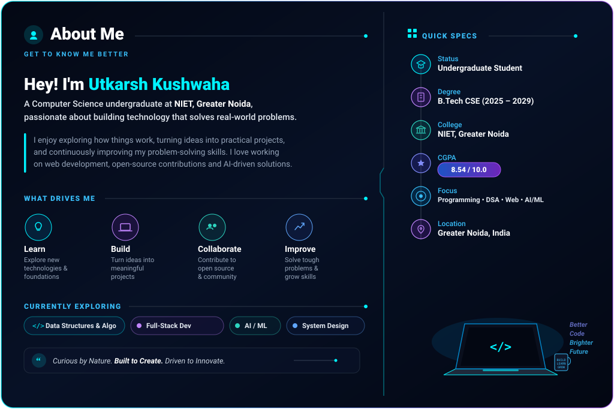

  <!-- ================= HEADER BANNER ================= -->
  <picture></picture>

  <!-- ================= TYPING DYNAMIC INTRODUCTION ================= -->
  <picture></picture>

    

  <!-- ================= APPROVED NAVIGATION BADGES ================= -->
  

    
    &nbsp;
    
    &nbsp;
    
    &nbsp;
    
  

---

### 👨‍💻 &nbsp;About Me

  <picture></picture>

---

### 🛠️ &nbsp;Technical Skills

| Technical Domain | Core Technologies & Toolchains |
| :--- | :--- |
| **Programming Languages** | `Java` &nbsp;•&nbsp; `Python` &nbsp;•&nbsp; `C` &nbsp;•&nbsp; `JavaScript (ES6+)` |
| **Web Development** | `HTML5` &nbsp;•&nbsp; `CSS3` &nbsp;•&nbsp; `JavaScript` &nbsp;•&nbsp; `Responsive Design` |
| **Frameworks & Libraries** | `Flask` &nbsp;•&nbsp; `Chart.js` &nbsp;•&nbsp; `Leaflet.js` |
| **Databases** | `SQLite` &nbsp;•&nbsp; `Relational Database Concepts` &nbsp;•&nbsp; `SQL Queries` |
| **Tools & Platforms** | `Git` &nbsp;•&nbsp; `GitHub` &nbsp;•&nbsp; `VS Code` &nbsp;•&nbsp; `GDB` &nbsp;•&nbsp; `Vercel` |
| **Core Computer Science** | `Data Structures & Algorithms` &nbsp;•&nbsp; `OOP` &nbsp;•&nbsp; `DBMS` &nbsp;•&nbsp; `Computer Architecture` |

 

  <picture></picture>
  &nbsp;
  <picture></picture>
  &nbsp;
  <picture></picture>
  &nbsp;
  <picture></picture>
  &nbsp;
  <picture></picture>
  &nbsp;
  <picture></picture>
  &nbsp;
  <picture></picture>
  &nbsp;
  <picture></picture>
  &nbsp;
  <picture></picture>
  &nbsp;
  <picture></picture>

---

### 🚀 &nbsp;Featured Projects

<table>
  <!-- Row 1 -->
  <tr>
    <td width="50%" valign="top">
      

        <picture></picture>
        <h3>⚡ Watt's Off — Energy Anomaly Detection</h3>
      

      
An energy-monitoring platform designed to detect abnormal electricity consumption patterns and potential theft using statistical anomaly detection algorithms.

      <ul>
        <li><b>Engineered Logic:</b> Python statistical deviation engine identifying usage spikes and irregular loads across power consumer nodes.</li>
        <li><b>Visualization:</b> Geospatial mapping with Leaflet.js and real-time analytical charts with Chart.js for portal dashboards.</li>
      </ul>
      

        <picture></picture>
        <picture></picture>
        <picture></picture>
        <picture></picture>
      

      

        
      

    </td>
    <td width="50%" valign="top">
      

        <picture></picture>
        <h3>📋 Digital Complaint Management System (DCMS)</h3>
      

      
A structured citizen grievance logging and tracking platform engineered strictly around core Object-Oriented Programming (OOP) paradigms in Python.

      <ul>
        <li><b>Architecture:</b> Applied encapsulation, modular inheritance, polymorphism, decorators, generators, and recursive searching.</li>
        <li><b>Documentation:</b> Authored 30+ pages of detailed engineering documentation, UML class models, and comprehensive test cases.</li>
      </ul>
      

        <picture></picture>
        <picture></picture>
        <picture></picture>
      

      

        
      

    </td>
  </tr>
  <!-- Row 2 -->
  <tr>
    <td width="50%" valign="top">
      

        <picture></picture>
        <h3>💳 ATM Transaction Logging & Cash Flow</h3>
      

      
A financial operations and transaction management application built around fundamental Data Structures and database principles.

      <ul>
        <li><b>DSA Implementation:</b> Implemented custom Linked Lists, Stacks, and Circular Queues for chronological transaction recording and rollback simulation.</li>
        <li><b>Integrity:</b> Persistent transaction records and automated alerts for cash replenishment thresholds.</li>
      </ul>
      

        <picture></picture>
        <picture></picture>
        <picture></picture>
      

      

        
      

    </td>
    <td width="50%" valign="top">
      

        <picture></picture>
        <h3>🛡️ DeepScan AI — Multi-Modal Deepfake Detection</h3>
      

      
An experimental AI system designed to detect and flag synthetic manipulations and deepfakes across images, video sequences, and audio streams.

      <ul>
        <li><b>Model Analysis:</b> Multi-layer facial landmark consistency verification and frequency artifact inspection.</li>
        <li><b>Verification:</b> Real-time frame extractor identifying temporal inconsistencies across multi-modal media assets.</li>
      </ul>
      

        <picture></picture>
        <picture></picture>
        <picture></picture>
      

      

        
      

    </td>
  </tr>
  <!-- Row 3 -->
  <tr>
    <td colspan="2" valign="top">
      

        <picture></picture>
        <h3>🌐 Personal Developer Portfolio Website</h3>
      

      
A responsive personal website presenting academic milestones, practical projects, technical proficiencies, and contact information.

      <ul>
        <li><b>Highlights:</b> Clean semantic HTML5, fluid cross-device layout design, modular CSS structure, and automated deployment via Vercel.</li>
      </ul>
      

        <picture></picture>
        <picture></picture>
        <picture></picture>
        <picture></picture>
      

      

        
        &nbsp;
        
      

    </td>
  </tr>
</table>

---

### 💼 &nbsp;Professional Experience & Contributions

<table width="100%">
<tr>
<td width="33.33%" valign="top">

<picture></picture>
 
<b>Web Development Intern</b>
 
<b>InAmigos Foundation (IAF)</b>
  
<picture></picture>
 
<picture></picture>

<ul>
<li>Developed responsive web interfaces using semantic <b>HTML5 & CSS3</b>.</li>
<li>Improved cross-device compatibility and optimized core page performance.</li>
<li>Refined UI/UX layouts and digital assets for visual consistency.</li>
</ul>

<picture></picture>
<picture></picture>
<picture></picture>

</td>
<td width="33.33%" valign="top">

<picture></picture>
 
<b>Open Source Contributor</b>
 
<b>GirlScript Summer of Code (GSSoC 2026)</b>
  
<picture></picture>
 
<picture></picture>

<ul>
<li>Resolved bugs and contributed modular frontend components across active repositories.</li>
<li>Wrote maintainable <b>HTML, CSS, and JavaScript</b> code adhering to peer review standards.</li>
<li>Collaborated through GitHub issues and pull requests; improved documentation and test coverage.</li>
</ul>

<picture></picture>
<picture></picture>
<picture></picture>

</td>
<td width="33.33%" valign="top">

<picture></picture>
 
<b>Technology Job Simulation</b>
 
<b>Deloitte Australia (Forage)</b>
  
<picture></picture>
 
<picture></picture>

<ul>
<li>Completed simulated software and technology development tasks based on enterprise briefs.</li>
<li>Prepared an end-to-end technology architecture proposal for an organizational dashboard.</li>
<li>Conducted basic security considerations and data requirements auditing for dashboard analytics.</li>
</ul>

<picture></picture>
<picture></picture>

</td>
</tr>
</table>

---

### 🏅 &nbsp;Achievements & Hackathons

<table>
  <tr>
    <td width="60%" valign="top">
      

        <picture></picture>
        <h4>🏆 Smart India Hackathon (SIH 2026) — Team DoraByte</h4>
      

      
<b>Selected in NIET Internal SIH 2026</b> to represent the institution with an AI-driven real-time crisis assessment platform.

      <ul>
        <li><b>Stress & Trauma Assessment Module:</b> Architected an evaluation engine using NLP, Speech Analytics, and Emotion AI.</li>
        <li><b>Stress Vulnerability Index (SVI):</b> Formulated a risk-scoring index categorizing distress levels.</li>
        <li><b>Silent Distress Mode:</b> Proposed discreet emergency triggers for safe crisis intervention.</li>
      </ul>
    </td>
    <td width="40%" valign="top">
      

        <picture></picture>
        <h4>🛡️ Specialized Hackathons</h4>
      

      
<b>IntrusionX Cybersecurity Hackathon:</b>

      <ul>
        <li>Competed across multi-track cybersecurity challenges including AI/ML security, Web exploit mitigation, Cloud infrastructure, and IoT defense.</li>
      </ul>
      
<b>Paytm Build for India AI Hackathon:</b>

      <ul>
        <li>Participated in AI-driven innovation tracks exploring anomaly detection for merchant growth and automated workflows.</li>
      </ul>
    </td>
  </tr>
</table>

---

### 📊 &nbsp;GitHub Analytics & Activity

  

    
  

<!-- Dynamic Streak & Contribution Highlights Card -->

  <picture></picture>

 

<!-- Profile Overview Statistics & Top Languages Cards -->

  <table border="0">
    <tr>
      <td align="center" valign="middle">
        <picture></picture>
      </td>
      <td align="center" valign="middle">
        <picture></picture>
      </td>
    </tr>
  </table>

 

<!-- Verified Contribution Heatmap Graph -->

  <table border="0" width="95%">
    <tr>
      <td align="center" bgcolor="#0a0f1d">
        

          <b>ANNUAL CONTRIBUTION ACTIVITY HEATMAP</b>
        

        <picture></picture>
      </td>
    </tr>
  </table>

---

### 🎯 &nbsp;Currently Learning & Areas of Focus

<table>
  <tr>
    <td width="25%" align="center">
      <b>🧩 Algorithmic Problem Solving</b> 
      Trees, Graphs, Dynamic Programming & Complexity Optimization
    </td>
    <td width="25%" align="center">
      <b>🏗️ Scalable Software Design</b> 
      Modular Architecture, Clean REST APIs & Relational Database Design
    </td>
    <td width="25%" align="center">
      <b>🤖 Applied AI & Automation</b> 
      Integrating Machine Learning Models and Computer Vision into Web Applications
    </td>
    <td width="25%" align="center">
      <b>🔒 System Security & Hardening</b> 
      Secure Coding Standards, Defense Against Common Vulnerabilities & Cryptography
    </td>
  </tr>
</table>

---

### 📬 &nbsp;Let's Connect

I am always keen to collaborate on interesting student projects, participate in hackathons, or contribute to open-source initiatives. Feel free to reach out through any of the channels below:

| Channel | Platform Handle / Address | Action |
| :---: | :---: | :---: |
| 🌐 **Live Portfolio** | `utkarsh-kushwaha-portfolio.vercel.app` | [**Visit Website ↗**](https://utkarsh-kushwaha-portfolio.vercel.app/) |
| 💼 **LinkedIn Profile** | `linkedin.com/in/utkarsh-kk` | [**Connect on LinkedIn ↗**](https://www.linkedin.com/in/utkarsh-kk) |
| 🐙 **GitHub Repositories** | `github.com/utkarshkushwaha159` | [**Follow on GitHub ↗**](https://github.com/utkarshkushwaha159) |
| 📧 **Direct Email** | `hey.utkarsh.tech@gmail.com` | [**Send an Email ➔**](mailto:hey.utkarsh.tech@gmail.com) |

 

  <!-- ================= MINIMAL ELEGANT FOOTER ================= -->
  <picture></picture>

  

    Designed with precision & authenticity • <b>Utkarsh Kushwaha</b> • <i>"Curious by Nature. Built to Create. Driven to Innovate."</i>
  

